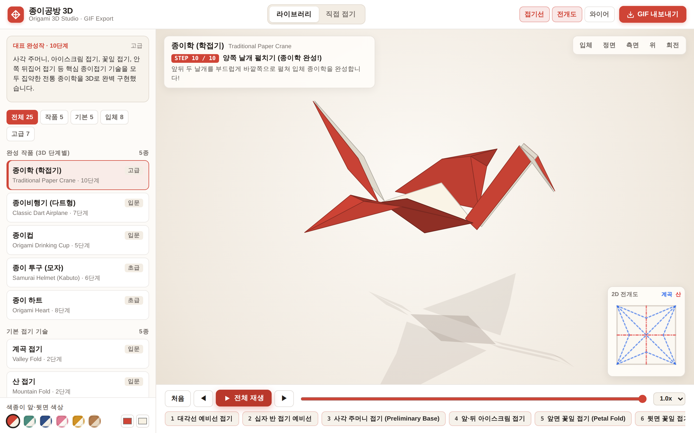
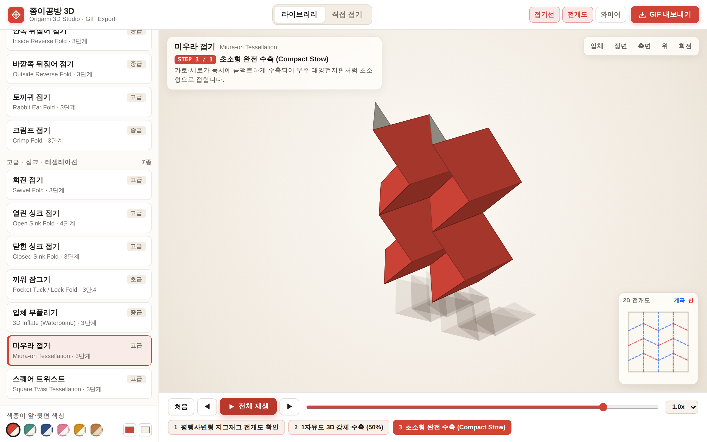
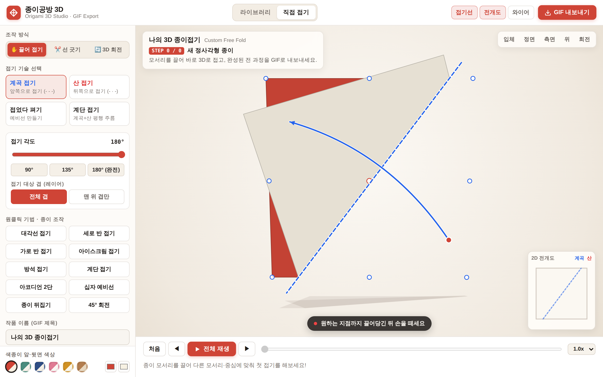
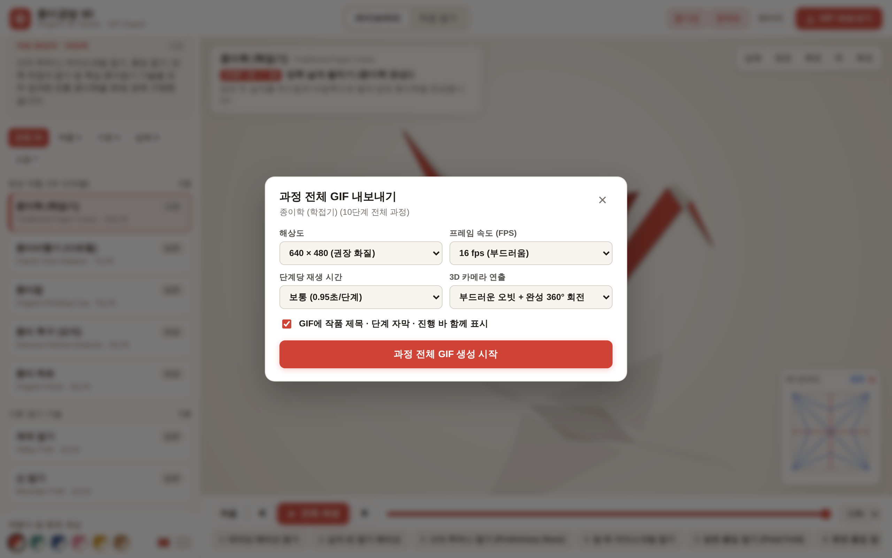
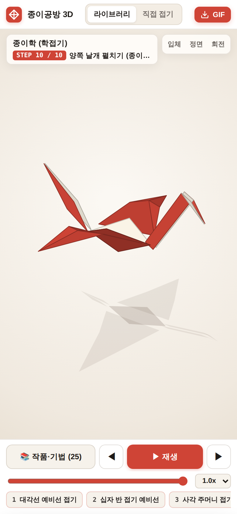
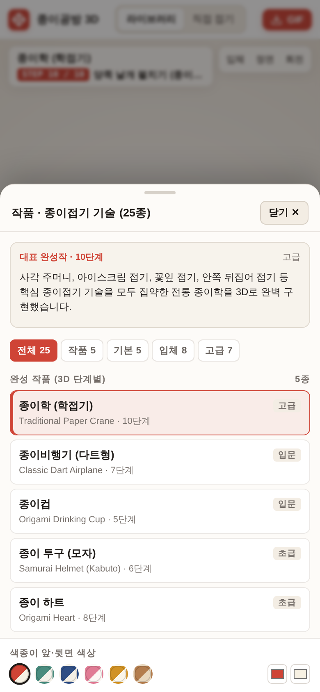
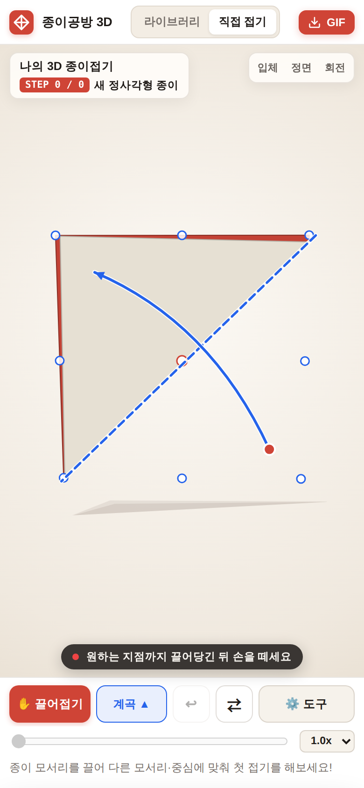
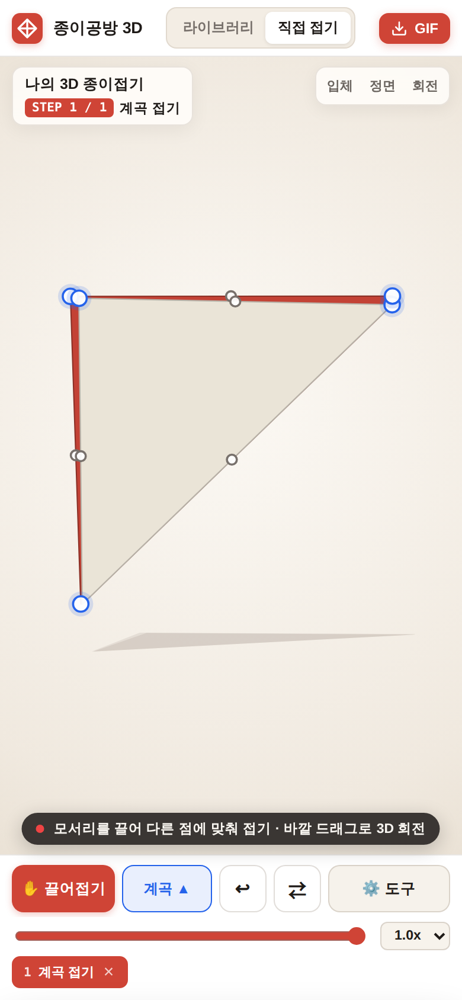

# 종이공방 3D (Origami 3D Studio)

알려진 종이접기 기술 **전 분야 20종**을 3D 강체 기구학으로 구현하고, 직접 만들거나 선택한 작품의 접기 과정 전체를 애니메이션 GIF로 내보내는 3D 종이접기 프로그램입니다.

## Vercel 배포
- 상단 **Deploy with Vercel** 버튼을 클릭하거나 [Vercel Import 페이지](https://vercel.com/new/import?s=https://github.com/knoxxr/origami-3d-studio)에서 `knoxxr/origami-3d-studio` 저장소를 선택하면 `vercel.json` 설정(`node build.js` -> `public/`)으로 자동 빌드·배포됩니다.

## 스크린샷

### 데스크톱
| 3D 종이학 & 2D 전개도 | 미우라 접기 (테셀레이션) |
| :---: | :---: |
|  |  |

| 직관적 드래그 종이접기 | 과정 전체 GIF 내보내기 |
| :---: | :---: |
|  |  |

### 모바일 (터치 UI & 직관적 끌어접기)
| 모바일 3D 뷰어 | 슬라이드업 바텀 시트 | 모서리 끌어접기 (미리보기) | 접기 완료 (STEP 1) |
| :---: | :---: | :---: | :---: |
|  |  |  |  |

## 주요 기능

### 1. 알려진 종이접기 기술 3D 구현 (총 20종)
- **기본 (5종)**: 계곡 접기, 산 접기, 접었다 펴기(기준선 격자), 방석 접기, 계단 접기
- **입체 · 기본형 · 반전 (8종)**: 사각 주머니 접기, 삼각 주머니 접기, 눌러 접기, 꽃잎 접기, 안쪽 뒤집어 접기, 바깥쪽 뒤집어 접기, 토끼귀 접기, 크림프 접기
- **고급 · 싱크 · 입체 성형 · 테셀레이션 (7종)**: 회전 접기(Swivel), 열린 싱크 접기, 닫힌 싱크 접기, 끼워 잠그기(Pocket Tuck), 입체 부풀리기(3D Inflate), 미우라 접기(Miura-ori), 스퀘어 트위스트(Square Twist)

### 2. 완성 작품 3D 단계별 시뮬레이션 (5종)
- **종이학 (Traditional Paper Crane, 10단계)**
- **종이비행기 다트형 (Classic Dart Airplane, 7단계)**
- **종이컵 (Origami Drinking Cup, 5단계)**
- **종이 투구 (Samurai Kabuto, 6단계)**
- **종이 하트 (Origami Heart, 8단계)**

### 3. 자유 창작 스튜디오 (Free Fold Studio)
- 3D 캔버스 위 꼭짓점·중점·중심 **자동 스냅 3클릭 접기** (시작점 -> 끝점 -> 접을 영역 선택)
- 계곡/산/예비선/계단 접기, 접기 각도(15°~180°), 전체 겹 / 맨 위 겹만 선택
- 원클릭 기법 매크로, 종이 뒤집기/회전, 실행 취소/다시 실행, 실시간 **2D 전개도(Crease Pattern)** 동기화

### 4. 과정 전체 애니메이션 GIF 내보내기
- 외부 서버나 CDN 없이 브라우저 내 **순수 JavaScript GIF89a 인코더** (Median-Cut 256색 양자화 + LZW 압축 + 무한 루프)로 직접 생성
- 시작(정사각형 종이)부터 모든 접기 단계 + 선택적 **완성작 360° 3D 회전 피날레**까지 한 번에 인코딩
- 해상도(480×360 / 640×480 / 800×600), FPS, 속도, 카메라 연출, 단계 자막 오버레이 설정 및 즉시 미리보기·다운로드

## 프로젝트 구조
- `src/math3d.js` — 3D 벡터 연산, Rodrigues 축 회전, Sutherland-Hodgman 평면 다각형 분할, 투영 카메라
- `src/planarEngine.js` — 평면 종이접기 커널, 레이어 적층 정렬, 계단 접기, 스냅 포인트 추출
- `src/kinematicModels.js` — 8종 종이접기 기술 및 5종 완성 작품 3D 강체 기구학 모델
- `src/renderer3d.js` — 위상 평면 깊이 정렬(Topological Painter's Sort), 양면 한지 셰이딩, 2D 전개도 및 GIF 자막 렌더러
- `src/gifEncoder.js` — 순수 JS GIF89a 인코더
- `src/app.js` — 인터랙티브 스튜디오 UI 및 GIF 내보내기 컨트롤러
- `build.js` — 단일 자체 완결 HTML 번들러 (`dist/origami_3d_studio.html`)
- `test/verify.mjs` — 기하학·등거리성·GIF 인코더 자동 검증 스크립트
